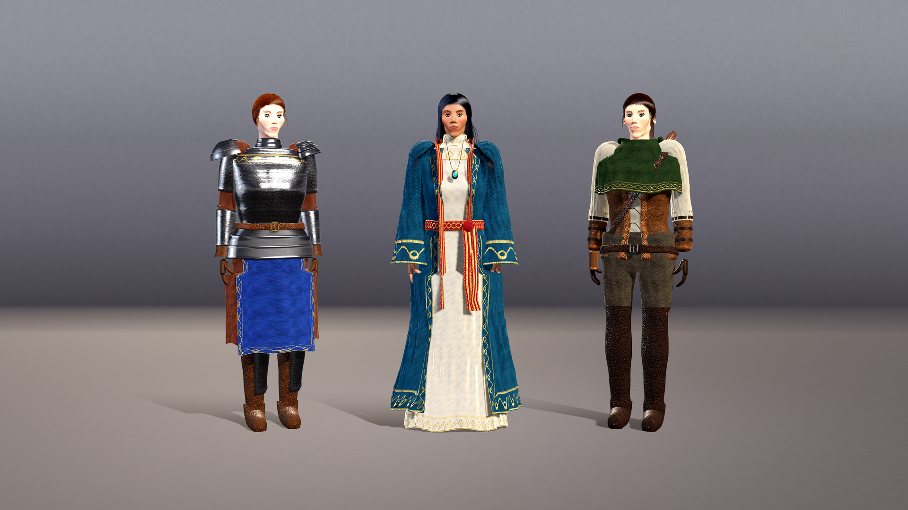
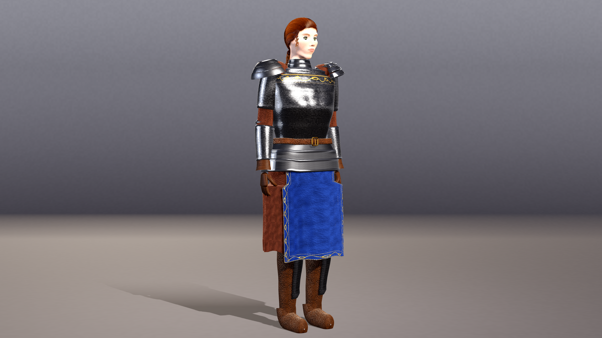
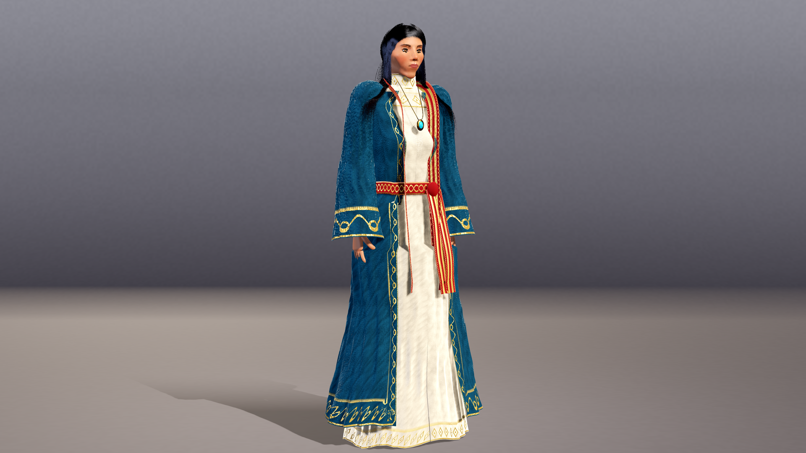
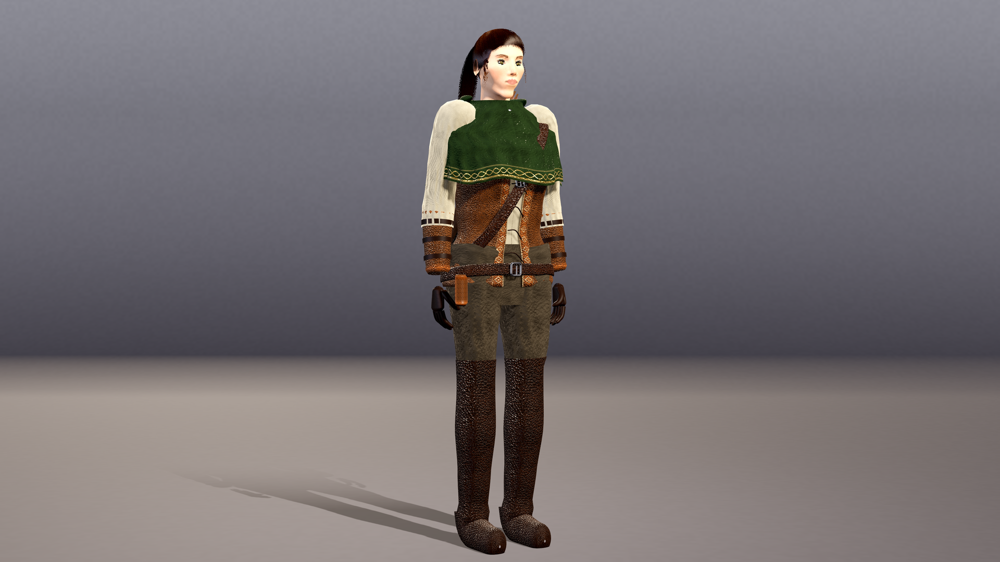
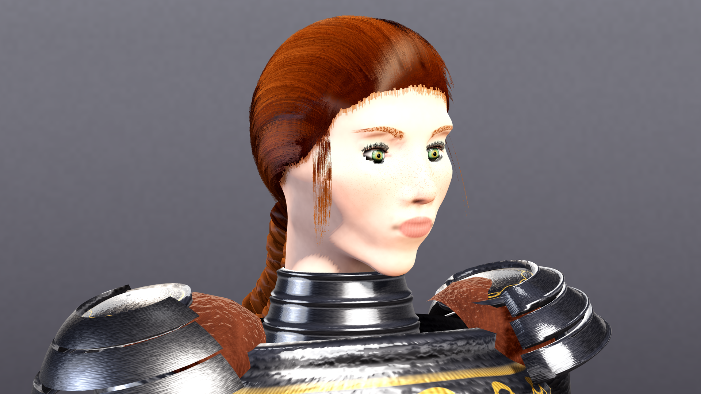
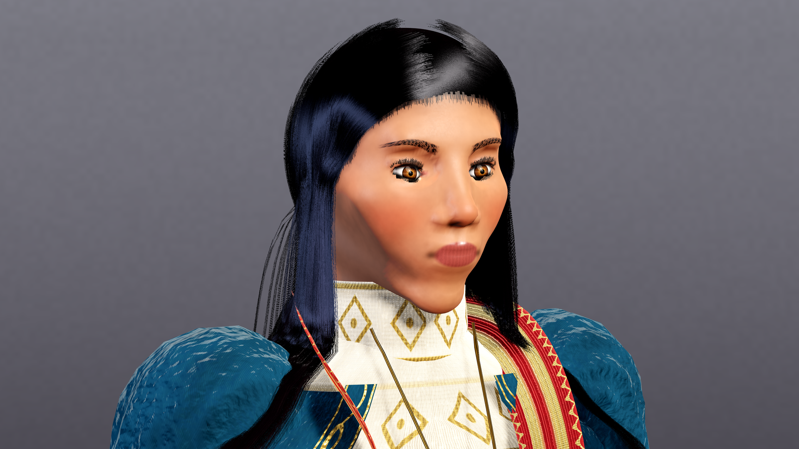
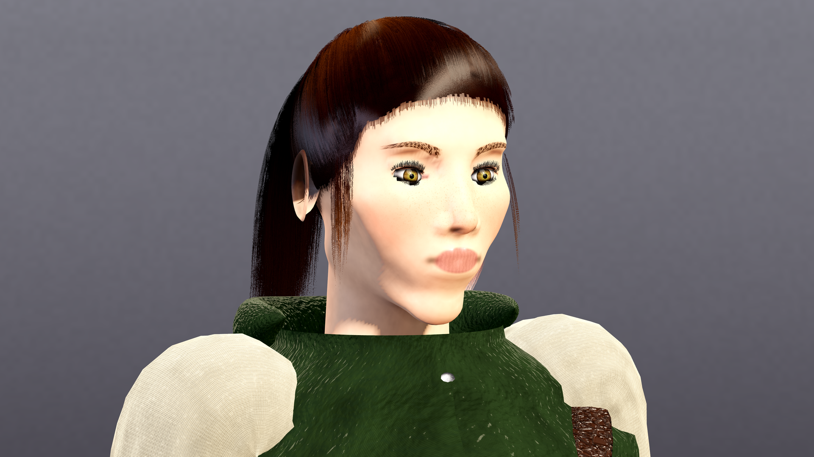
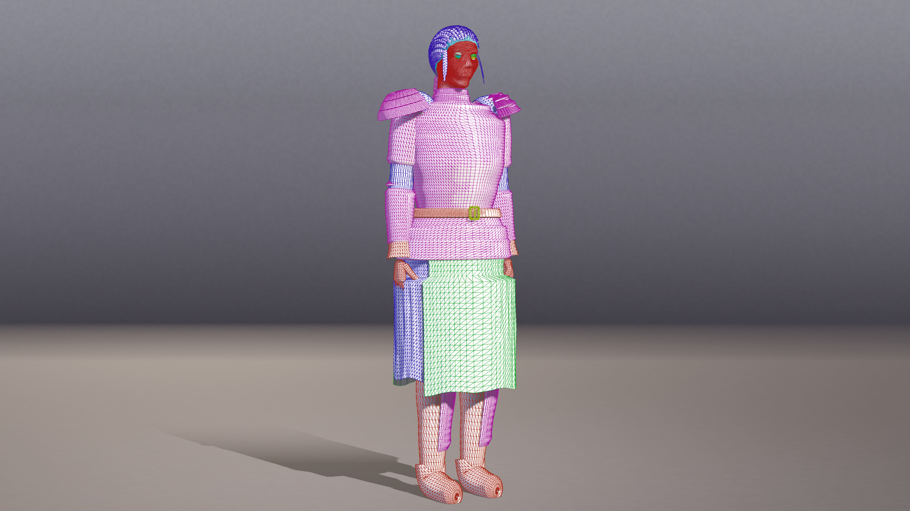
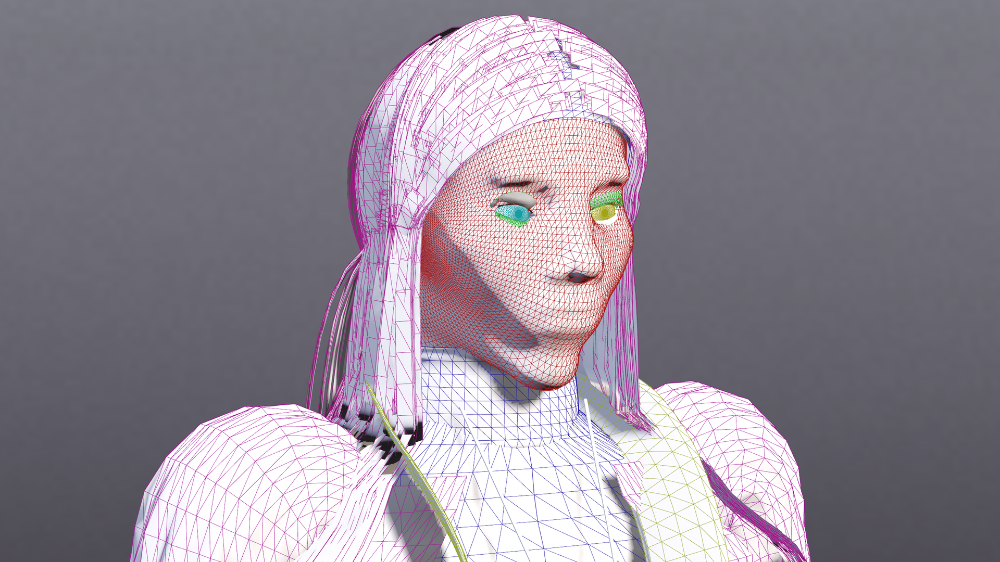

# Codeborn Heroines



Codeborn Heroines is three detailed 3D fantasy characters, an armoured paladin, a robed mage and a leather-clad ranger, built in Godot 4.7.2 with **zero asset files**. Bodies, faces, eyes, hair, clothing, armour, materials and the studio lighting are all generated from about 2,400 lines of GDScript, with no meshes, textures or images loaded from disk. It's a test of how far the code-only approach of [The Ninth Vigil](https://github.com/iamlukethedev/The-Ninth-Vigil) can go with realistic characters.

## Features

- A head built by tracing a signed-distance field, and a parametric body (`head.gd`, `body.gd`, `face.gd`), with separate eye meshes and lashes
- Strand-card hair, braids and hair caps (`hair.gd`)
- Layered outfits for each character (`outfits.gd`): plate armour, a tabard, an embroidered robe and sash, leather, a cloak, and a quiver with fletched arrows
- Procedural noise texture maps with Sobel normal maps (`texgen.gd`), and shaders written in code for skin, eyes, hair and surfaces (`shaders.gd`)
- A studio rig (`studio.gd`) and a render driver with hero, face, wireframe, lineup and turntable modes (`main.gd`)

| Paladin | Mage | Ranger |
|---|---|---|
|  |  |  |
|  |  |  |

## How to run

You need [Godot 4.7.2](https://godotengine.org/download). The project uses the Compatibility renderer. The scripts below expect Linux with `xvfb-run` and `ffmpeg`, and the path to Godot in `GODOT`.

```bash
export GODOT=/path/to/godot-4.7.2

# render one still into out/
./run.sh 1920x1080 res://main.tscn --mode=hero --char=mage --out=hero_mage
#   --mode=hero|face|wire|wireface|lineup|turntable   --char=paladin|mage|ranger

# render the full set of supersampled stills into final/
./final.sh

# parse-check every script
./check.sh
```

You can also open the project in the Godot editor and run `main.tscn`.

## Tech notes

These numbers come from the final render logs (software OpenGL, no GPU):

| Character | Triangles | Build time |
|---|---|---|
| Paladin | 148,048 | 11.2-11.8 s |
| Mage | 131,936 | 7.4-7.9 s |
| Ranger | 111,940 | 7.8-8.8 s |

- The median frame time for stills was about 0.4-0.76 s per frame on the software renderer.
- About 2,400 lines of GDScript in 13 files.
- Honest limits: the clothing and armour hold up well, especially the embroidered robe and the polished plate. Up close, though, the faces look like sculpted clay and the hairlines are too crisp. The Compatibility renderer used here has no soft shadowing or real subsurface skin scattering.

| Wireframe | Face wireframe |
|---|---|
|  |  |

Turntable: [media/turntable_720p.mp4](media/turntable_720p.mp4). Per-part triangle counts: [media/triangle_counts.txt](media/triangle_counts.txt).

## Credits

- Inspired by the zero-asset approach of [The Ninth Vigil](https://github.com/iamlukethedev/The-Ninth-Vigil) by iamlukethedev (MIT). No code was copied from it.
- The code was written by an AI agent.
- Built with the [Godot Engine](https://godotengine.org).
